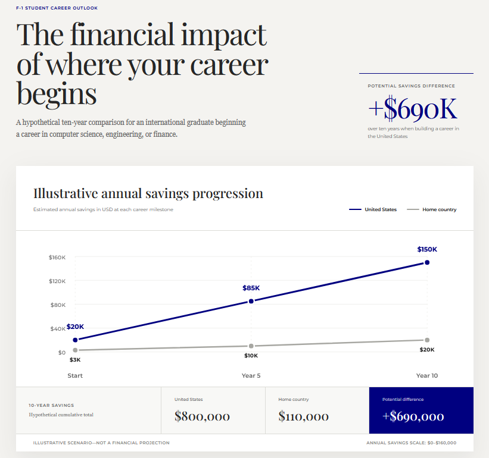
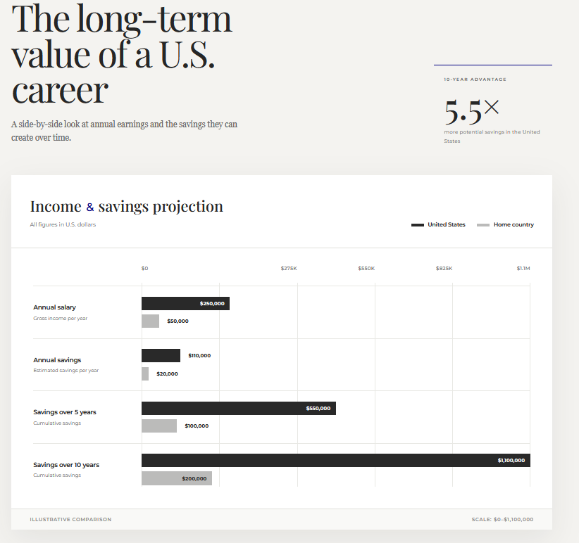

<intro>EB-5 inflation adjustment is the first scheduled change to EB-5 minimum investments on January 1, 2027. The 2022 Reform and Integrity Act set that date for the first statutory Consumer Price Index adjustment. New amounts apply to petitions filed on or after that date. It is not a general application deadline for the program. F-1 students and H-1B professionals who want to use the current $800,000 TEA or $1,050,000 standard minimums should begin source-of-funds and filing work well before January 1, 2027. The September 30, 2026 grandfathering deadline is a separate date that protects already-filed petitions if Congress later changes or lets the regional center program lapse.</intro>

EB-5 can give F-1 students and H-1B professionals a self-sponsored route to U.S. permanent residence. The January 1, 2027 date only changes the statutory investment minimums for new filings. It does not close the program. For petition-protection rules tied to September 30, 2026 and regional center reauthorization on September 30, 2027, see our <a href="/research/eb5-grandfathering-2026-2027-deadlines">EB-5 grandfathering deadline guide</a>.

## What changes on January 1, 2027?

As of October 21, 2026, USCIS lists:

- $1,050,000 for standard investments outside Targeted Employment Areas (TEAs)
- $800,000 for investments in TEAs or qualifying infrastructure projects

A TEA is a rural area or an area designated for high unemployment.

Future amounts follow the Consumer Price Index for All Urban Consumers (CPI-U). USCIS has not published the revised 2027 dollar amounts. Treat any third-party projection as unofficial until USCIS or the Federal Register states the adjusted figures and the effective-date rules.

## Why the January 1, 2027 date matters for F-1 students

International students in the United States often have a short window after graduation to choose an immigration path.

An F-1 student may qualify for Optional Practical Training, which generally permits up to 12 months of employment after graduation. Eligible STEM graduates can apply for a 24-month STEM OPT extension. These programs allow professional experience. They do not grant permanent residence. Many graduates then seek H-1B sponsorship. Selection is not guaranteed. A student who does not secure another qualifying status generally must leave the United States.

EB-5 can offer a self-sponsored filing path. Eligible applicants who file Form I-485 with a pending immigrant petition may later request an Employment Authorization Document and Advance Parole. Those documents, if approved, allow work and travel while the case is pending. An I-526E filing by itself does not authorize employment. For the F-1 filing sequence, see the <a href="/research/f1-students/f1-to-eb5-green-card">F-1 to EB-5 green card guide</a>.

Students should also weigh what U.S. permanent residence can do to long-term earnings. Consider an F-1 graduate in computer science, engineering, or finance who might earn $85,000 a year in the United States and $20,000 in a home-country role.

The chart is an illustration, not observed salary data or a guarantee of future earnings. Under those assumptions, remaining in the United States can produce a large savings gap over a decade. For a broader lifetime-earnings comparison, see <a href="/research/comparisons/is-eb5-worth-it-indian-chinese-students">whether EB-5 is worth it for Indian and Chinese international students</a>.

## Why H-1B holders should review EB-5 before January 1, 2027

H-1B professionals who have careers, families, and children in the United States often earn more in the United States than they would in their home countries. EB-5 is an investor classification. It does not require an employer to sponsor the EB-5 petition. The investor still must meet the capital, job-creation, and lawful-source rules.

The financial cost of leaving the United States can be large. Consider an H-1B professional earning $250,000 a year in the United States and $50,000 in a home-country role.

The chart is an illustration, not observed salary data or a guarantee of future earnings. Under those assumptions, staying in the United States can be financially significant. That comparison does not include later investment returns, professional networks, or quality-of-life factors.

Unlike the proposed Trump Gold Card, which is described as a nonrefundable contribution, EB-5 capital is an at-risk investment that a project may later return if it performs. Return of capital is not guaranteed. For the program comparison, see <a href="/research/eb5-vs-trump-gold-card-2026">EB-5 vs Trump Gold Card</a>.

Filing before January 1, 2027 allows eligible applicants to use the current listed investment thresholds. A petition filed after the adjustment takes effect is subject to the revised amounts.

## What F-1 students and H-1B holders should do before the end of 2026

The remaining months of 2026 are a planning window to test whether EB-5 fits before the scheduled investment adjustment.

F-1 students should review current status, graduation date, OPT or STEM OPT eligibility, and any pending policy changes that affect student work programs.

H-1B professionals should review existing employment-based options, visa availability, available capital, and whether EB-5 belongs in the overall strategy. See the <a href="/research/h1b-eb5-financial-planning">H-1B EB-5 financial planning</a> guide for budget and source-of-funds sequencing.

Both groups should assemble lawful source-of-funds records, review project risk, and obtain advice from a qualified U.S. immigration attorney and an independent investment adviser. For student-family funding structures, see <a href="/research/f1-students/eb5-funding-strategies-students">EB-5 funding strategies for international students</a>.

The statutory adjustment may change the minimum amount required for new EB-5 petitions. It does not change the duty to maintain status or to complete the documentation needed to show eligibility.

## Frequently asked questions about the EB-5 inflation adjustment

<h3>Will the EB-5 minimum investment increase on January 1, 2027?</h3>

The statute schedules the first inflation adjustment for January 1, 2027. As of October 21, 2026, USCIS has not published the revised investment amounts. The current listed thresholds are $800,000 for qualifying reduced-threshold investments and $1,050,000 for standard investments.

<h3>Can an F-1 student get a green card through EB-5?</h3>

Yes. An eligible F-1 student can pursue permanent residence through EB-5. An EB-5 petition does not automatically provide lawful status, employment authorization, or permanent residence.

<h3>Can an H-1B holder apply for EB-5 without employer sponsorship?</h3>

Yes. EB-5 is an investor-based immigrant visa classification and does not require an employer to sponsor the EB-5 petition. The investor must independently satisfy the applicable EB-5 requirements.

<h3>Can I file EB-5 and Form I-485 at the same time?</h3>

Eligible applicants in the United States may file concurrently when an immigrant visa is immediately available and all applicable adjustment-of-status requirements are met. The concurrent-filing rules are covered in <a href="/research/j1-f1-h1b-eb5-concurrent-filing">EB-5 concurrent filing for J-1, F-1, and H-1B holders</a>.

<h3>What happens if I wait until after January 1, 2027, to file EB-5?</h3>

A petition filed after the statutory adjustment takes effect will be subject to the applicable revised investment requirements. Applicants should consult official USCIS guidance for the adjusted thresholds and effective-date rules.

<h3>Does an EB-5 application allow international students to work in the United States?</h3>

An EB-5 immigrant petition does not provide employment authorization. An eligible applicant with a pending Form I-485 may request an Employment Authorization Document but must receive authorization before working, unless separately authorized.

## International residency alternatives to EB-5

For F-1 students and H-1B professionals considering options outside the United States, several international residency programs may provide alternatives. This section is an overview only. For the student-focused comparison, see <a href="/research/golden-visas-vs-eb5-elite-students">golden visas vs EB-5</a>.

### Portugal HQA residency

Portugal's Highly Qualified Activity (HQA) pathway may appeal to professionals in technology, engineering, research, and other specialized fields. It offers qualifying applicants a potential route to Portuguese residency without a U.S. employer sponsor.

### Argentina citizenship by investment

Argentina announced a proposed citizenship-by-investment program in October 2026, including a $350,000 non-refundable contribution and an $800,000 bond option. Implementation details remain unresolved, and an operational application process has not been verified. Follow official updates from the <a href="https://www.argentina.gob.ar/noticias/luis-caputo-anuncio-la-puesta-en-marcha-del-programa-de-ciudadania-por-inversion-de">Argentine government announcement</a>.

### Other golden visa programs

Portugal, Greece, Italy, and the UAE offer investment-based or other qualifying long-term residency pathways. Requirements, costs, and potential routes to citizenship vary.

For additional research, see <a href="https://www.henleyglobal.com/publications">Henley &amp; Partners research</a> and <a href="https://nomadcapitalist.com/finance/greece-vs-portugal-golden-visa/">Nomad Capitalist on Greece vs. Portugal golden visas</a>.

## References and further reading

### U.S. government and legal sources

1. <a href="https://www.uscis.gov/working-in-the-united-states/permanent-workers/employment-based-immigration-fifth-preference-eb-5/about-the-eb-5-visa-classification">USCIS: About the EB-5 Visa Classification</a>
2. <a href="https://www.uscis.gov/working-in-the-united-states/permanent-workers/employment-based-immigration-fifth-preference-eb-5/eb-5-immigrant-investor-process">USCIS: EB-5 Immigrant Investor Process</a>
3. <a href="https://www.law.cornell.edu/uscode/text/8/1153">8 U.S.C. § 1153: Allocation of Immigrant Visas</a>
4. <a href="https://www.uscis.gov/working-in-the-united-states/students-and-exchange-visitors/optional-practical-training-opt-for-f-1-students">USCIS: Optional Practical Training for F-1 Students</a>
5. <a href="https://www.uscis.gov/green-card/while-your-green-card-application-is-pending">USCIS: While Your Green Card Application Is Pending</a>
6. <a href="https://travel.state.gov/content/travel/en/legal/visa-law0/visa-bulletin.html">U.S. Department of State: Visa Bulletin</a>

### International residency and investment migration resources

7. <a href="https://aima.gov.pt/pt/viver/autorizacao-de-residencia-para-exercicio-de-atividade-profissional-altamente-qualificada">Portugal HQA residency information (AIMA)</a>
8. <a href="https://www.argentina.gob.ar/noticias/luis-caputo-anuncio-la-puesta-en-marcha-del-programa-de-ciudadania-por-inversion-de">Argentina: official citizenship-by-investment announcement</a>
9. <a href="https://www.henleyglobal.com/publications">Henley &amp; Partners: Research and Publications</a>
10. <a href="https://nomadcapitalist.com/finance/greece-vs-portugal-golden-visa/">Nomad Capitalist: Greece vs. Portugal Golden Visa</a>

Disclaimer: This article provides general information and does not constitute immigration, legal, tax, financial, or investment advice. EB-5 eligibility, adjustment-of-status options, and international residency requirements depend on individual circumstances and current law. Prospective applicants should consult a qualified U.S. immigration attorney, an independent investment adviser, and appropriate professionals in any foreign jurisdiction under consideration.

*The opinions expressed on this website are solely those of the author/presenter. The information provided is for general informational purposes only and should not be considered professional or legal advice. Student EB5 and its contributors do not endorse or take responsibility for any actions taken based on the information presented here. Visitors are strongly advised to consult with qualified immigration attorneys and financial advisors before making any EB-5 investment decisions or taking any actions based on the content on this website.*
